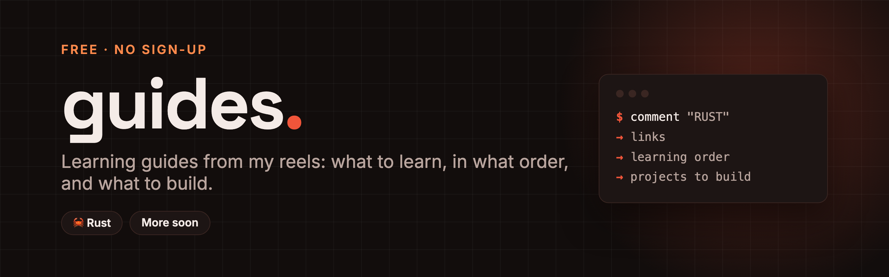
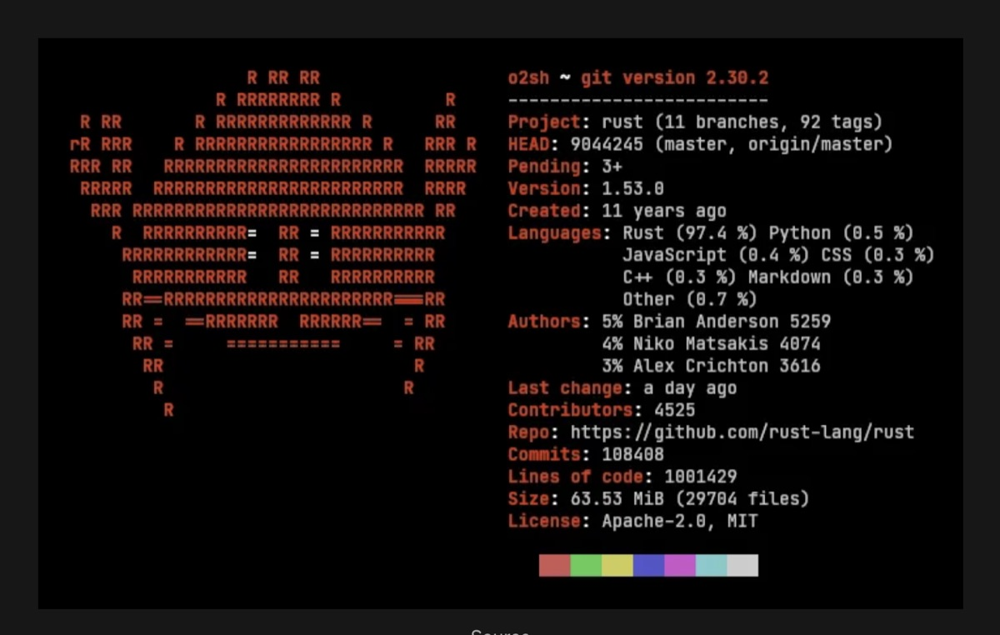

  

  
  
  

  Free learning guides from my reels: <b>what to learn, in what order, and what to build</b>. 
  No sign-up, no paywall. Just the best free resources I could find, in a sensible order.

---

## 📚 Guides

<table>
  <tr>
    <td width="260">
      
    </td>
    <td>
      <h3>🦀 How do I learn Rust?</h3>
      Why Rust matters (Google, Discord), what to learn in order (Rust 101 → The Rust Book → Rustlings → Google's and Microsoft's courses), then three projects to build, from a 15-minute CLI to your own operating system.
        
      <a href="https://dylantombs.github.io/guides/rust/"><b>Open the guide →</b></a> &nbsp;·&nbsp; <a href="rust/README.md">Read it here</a>
    </td>
  </tr>
</table>

More on the way.

## 🧭 How it works

1. **Watch the reel.** Each guide comes from one of my Instagram reels.
2. **Comment the keyword** (e.g. `RUST`) and I'll DM you the link.
3. **Follow the order.** Every guide goes *why → learn → build*, so you always know what's next.

Or skip all that and just browse the guides above.

## ✅ What every guide has

| | |
|---|---|
| 🔗 **Free resources only** | Courses, books and tutorials you can start today without paying. |
| 🪜 **A learning order** | Not a link dump. Each step says what you get from it. |
| 🛠️ **Projects to build** | Easiest first, so you finish with something real. |
| 📱 **Phone-friendly** | Built to open straight from an Instagram DM. |

---

Found a broken link or a better resource? <a href="../../issues">Open an issue</a>.

