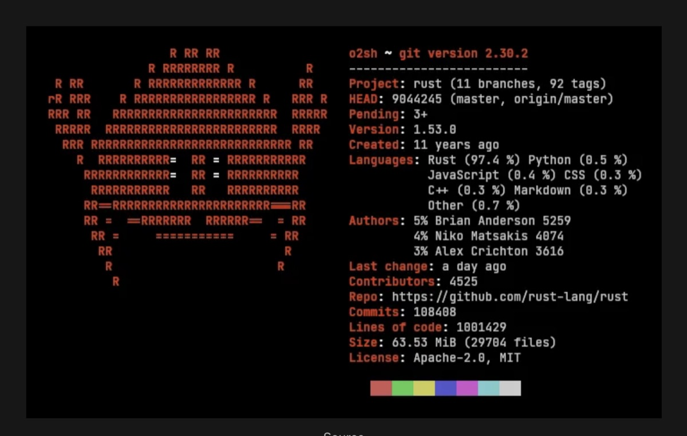

# rust

The list from my Rust reel. Web version: https://dylantombs.github.io/guides/rust/

Image from [Rust 101](https://medium.com/codex/rust-101-everything-you-need-to-know-about-rust-f3dd0ae99f4c).

Rust is a fast language without the memory bugs C and C++ are known for. Google's Android team says their Rust code has about 1000x fewer memory-safety bugs than their C/C++ ([Google, Nov 2025](https://blog.google/security/rust-in-android-move-fast-fix-things/)). Discord moved a service from Go to Rust to get rid of latency spikes ([Discord, 2020](https://discord.com/blog/why-discord-is-switching-from-go-to-rust)). If you want a longer case for it, watch Carol Nichols' talk [Rust: a language for the next 40 years](https://chariotsolutions.com/screencast/philly-ete-2019-carol-nichols-rust-a-language-for-the-next-40-years/).

## learn it in this order

1. [Rust 101](https://medium.com/codex/rust-101-everything-you-need-to-know-about-rust-f3dd0ae99f4c): a 9 minute overview so the rest makes sense
2. [The Rust Book](https://doc.rust-lang.org/book/), chapters 1 to 8
3. [Rustlings](https://github.com/rust-lang/rustlings) alongside the book, small exercises for each chapter
4. [Comprehensive Rust](https://google.github.io/comprehensive-rust/): the course Google uses to teach Rust to its own engineers
5. [Microsoft's RustTraining](https://microsoft.github.io/RustTraining/) if you already know Python, C# or C++

## then build something

1. [Your own grep](https://rust-cli.github.io/book/tutorial/index.html): a command line tool, about 15 minutes to get running
2. [A multithreaded web server](https://doc.rust-lang.org/book/ch21-00-final-project-a-web-server.html): the last project in the Rust Book
3. [Your own operating system](https://os.phil-opp.com/): a blog series that builds a small OS step by step

You can try Rust in the browser without installing anything: [Rust Playground](https://play.rust-lang.org/).
